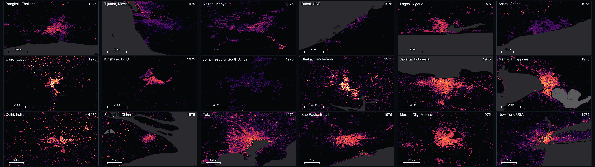

# Hi, I'm Andy Zimmer 👋

I'm a geographer and geospatial scientist at **Oak Ridge National Laboratory**, and affiliate researcher at **Montana State University**.

I study population change, migration, urbanization, and human–environment relationships. My research combines spatial demography, GIS, remote sensing, and field research in Southern Africa to understand how population dynamics shape livelihoods and environmental exposure. At ORNL, I contribute to the **LandScan program**, developing population datasets and models.

I also teach and mentor students in geography, climate, and geospatial analysis, helping them connect research questions with data and communicate their findings.

### Selected projects

- [Urban Demography](https://github.com/zimmermaps/urban_demography): Demographic change and migration across more than 10,000 cities.
- [Hypsographic Demography](https://github.com/zimmermaps/hypsographic_demography): Population structure and change across elevation gradients.

### Connect

[ORNL](https://www.ornl.gov/staff-profile/andrew-zimmer) · [Google Scholar](https://scholar.google.com/citations?user=1-Xk5zMAAAAJ) · [ORCID](https://orcid.org/0000-0001-7683-8713) · [Email](mailto:zimmera@ornl.gov)

